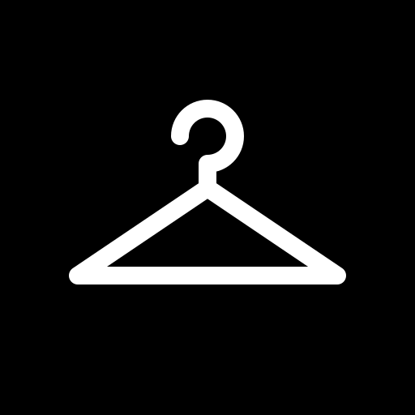

<div align="center">



# Armario Digital

**Tu armario, en blanco y negro.**<br>
Haz una foto a una prenda y la IA la convierte en una foto de catálogo, la recorta y la clasifica.<br>
Combina tus prendas en un maniquí, guarda outfits y pide consejo a un estilista que mira el tiempo por ti.

[](https://github.com/bonaquegar-sudo/ARMARIO-DIGITAL-IA/actions/workflows/ios.yml)


[**⬇ Descargar para iPad**](https://github.com/bonaquegar-sudo/ARMARIO-DIGITAL-IA/releases/download/ultima/ArmarioDigital.ipa)

</div>

---

## Qué hace

| | |
|---|---|
| **📸 Añadir prenda** | Haces una foto (aunque sea en la cama, mal iluminada) y Flux genera una foto de estudio tipo Zara o Bershka. La app quita el fondo **en el propio dispositivo** y guarda la prenda como PNG transparente. |
| **🏷️ Autoetiquetado** | Qwen mira la prenda y rellena categoría, tipo, color, estilo, temporada y una descripción. Puedes corregirlo todo. |
| **🧍 Probador** | Un maniquí digital: gorra arriba, accesorio a un lado, parte de arriba con la chaqueta al lado, pantalón y zapatos abajo. Cambias cada prenda con las flechas **‹ ›**. |
| **🗂️ Outfits** | Guarda combinaciones y vuelve a probártelas con un toque. |
| **💬 Chat estilista** | *«Estoy en Málaga, hazme un outfit para mañana»*: consulta el tiempo, elige prendas de **tu** armario, guarda el outfit y te explica por qué. |
| **🔁 Copia de seguridad** | Exporta todo el armario a un archivo `.armario` y ábrelo en el otro dispositivo. |

Diseño minimalista, solo blanco y negro, con modo claro y oscuro.

## Privacidad: todo es local

- Sin cuentas, sin servidor y sin nube propia. Tus prendas, fotos y outfits viven **solo en tu dispositivo**.
- Lo único que sale a internet son las llamadas a la IA (OpenRouter) con tu propia clave y la consulta del tiempo (Open-Meteo, sin clave).
- La clave de OpenRouter se guarda en el dispositivo y **nunca** se incluye en las copias de seguridad.

## Modelos de IA

Todos a través de [OpenRouter](https://openrouter.ai). Se pueden cambiar en **Ajustes**.

| Uso | Modelo | Coste aprox. |
|---|---|---|
| Foto de catálogo | `black-forest-labs/flux-3-image-klein` | ~0,01 $ por prenda |
| Etiquetado | `qwen/qwen3.6-35b-a3b` | céntimos de céntimo |
| Chat | `deepseek/deepseek-v4.1-flash` | céntimos de céntimo |

<details>
<summary><b>¿Cómo se recorta la prenda sin otro modelo de IA?</b></summary>

Flux pinta la prenda sobre un fondo **verde croma** (o **magenta** si la prenda es verde), igual que en un plató de cine. La app detecta ese color en los bordes y lo elimina de toda la imagen, incluidos los huecos (el interior de un collar, el asa de un bolso). Después quita el reflejo verde de los bordes y convierte las sombras en sombras suaves. Funciona con ropa blanca y negra y tarda unos 60 ms.

</details>

## Instalar

### 🖥️ Windows

Compila el instalador (necesitas [Rust](https://rustup.rs) y [Node.js](https://nodejs.org)):

```powershell
npm install
npm run build
```

El instalador queda en `src-tauri/target/release/bundle/nsis/`.

### 📱 iPad

Cada cambio en `main` compila automáticamente la app en un Mac en la nube ([GitHub Actions](.github/workflows/ios.yml)) y publica la `.ipa` en un enlace fijo:

**[ArmarioDigital.ipa](https://github.com/bonaquegar-sudo/ARMARIO-DIGITAL-IA/releases/download/ultima/ArmarioDigital.ipa)**

La `.ipa` va sin firmar; la firma [SideStore](https://sidestore.io) (gratis) con tu Apple ID:

1. Instala SideStore en el iPad siguiendo [su guía](https://docs.sidestore.io) (se hace una vez, con el cable y el PC).
2. En el iPad, activa **Ajustes → Privacidad y seguridad → Modo desarrollador**.
3. Descarga la `.ipa` desde el enlace de arriba (o déjala en iCloud Drive) y ábrela con **SideStore**.
4. Con un Apple ID gratuito la firma dura **7 días**: renueva desde SideStore con un toque. Si caduca, la app no abre hasta renovarla, pero **tus datos no se borran**.

> ¿Prefieres hacerlo desde Windows? [Sideloadly](https://sideloadly.io) instala la `.ipa` por cable o Wi-Fi.

### Primer uso

Abre **Ajustes** y pega tu clave de OpenRouter (`sk-or-…`). Listo.

## Pasar el armario entre el PC y el iPad

**Ajustes → Copia de seguridad → Exportar**

- En **Windows** el archivo se guarda directamente en **iCloud Drive** (si tienes iCloud para Windows) o en Documentos.
- En el **iPad** se guarda en **Archivos → En mi iPad → Armario Digital**.

En el otro dispositivo pulsa **Importar** y elige el archivo. Importar sustituye el armario de ese dispositivo.

## Desarrollo

```
src/                 la app (HTML + CSS + JS, sin frameworks ni compilación)
├─ app.js            navegación, armario, añadir prenda, ajustes
├─ ai.js             OpenRouter: foto de catálogo, etiquetado y chat
├─ imagen.js         recorte croma local → PNG transparente
├─ probador.js       maniquí con zonas y flechas
├─ outfits.js        outfits guardados
├─ chat.js           estilista con herramientas (tiempo, guardar outfit)
├─ tiempo.js         previsión de Open-Meteo
├─ db.js             IndexedDB + copias .armario
└─ ui.js             diálogos propios (aviso, confirmar, pedir)
src-tauri/           envoltorio Tauri 2 (Rust) para Windows e iOS
```

```powershell
npm run dev        # app de escritorio con recarga
npm run build      # instalador de Windows
npm run icon       # regenera los iconos desde icon.svg
```

---

<div align="center"><sub>Hecho con Tauri 2 · Rust · JavaScript sin dependencias</sub></div>
